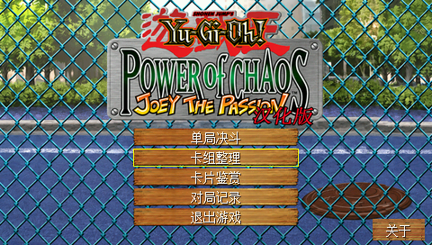
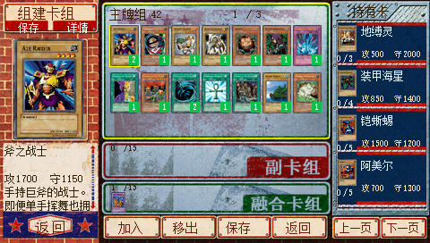
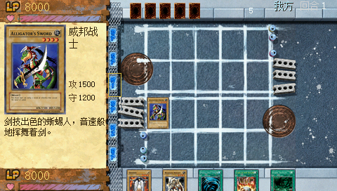

# 游戏王 H1 原生版

为步步高 **H1 / Y100 V1.41、480×272** 编写的《游戏王：混沌力量／城之内篇》兼容实现。决斗规则、组牌、对手 AI、界面和音频播放使用原生 MIPS C；运行时不加载原 PC 程序，也不执行 x86 指令。

已实现 1,115 条原版卡片记录的效果定义，保留经原版代码验证的历史行为，包括已确认的原版缺陷。原版数字规则的离线测试样例随源码提供，测试无需运行原 PC 游戏。测试有明确边界，不能穷举所有可能对局。

## 快速开始

当前版本 **0.1.0，发布准备阶段**；尚未创建远程仓库或公开 Release。本地构建后可在 `dist/JOEY.bda` 和 `dist/BBKH1-yugioh-v0.1.0-code-only.zip` 取得程序。

**源码和公开安装包不含商业游戏素材、汉化资源、音乐或宋体字库。** 需要自行提供已准备的兼容资源包；仅有原版 PC 安装目录不能直接运行。当前导入工具接受已经转换好的 H1 资源，尚未提供从原版 PC 安装包到全部资源的独立转换流程。来源及兼容版本哈希见 [ASSET_SOURCES.md](ASSET_SOURCES.md) 和 [资源说明](docs/RESOURCES.md)。

安装时，将自行准备的五个文件放入存储卡 `B:\JOEY\`：`FONT.BIN`、`H1UI.PAK`、`H1ART.PAK`、`H1SND.PAK`、`H1SCN.PAK`。程序复制到 `A:\应用\程序\游戏王.bda`，刷新桌面后从游戏分类启动“游戏王”。没有 B: 时也可使用 `A:\JOEY\`。保留已有的 `JNAT0.SAV` 和 `JNAT1.SAV`；更新程序不需要覆盖存档。

方向键移动焦点，确认键选择，ESC 返回，空格打开/关闭卡片详情，SHIFT+ESC 正常退出。也可触摸卡片和按钮；触摸棋盘左边的阶段图标推进阶段，最下面的结束阶段按钮结束回合。存在连锁或待选择效果时先完成该选择。音量默认 10%。主菜单支持单人决斗、组牌和关于；组牌包含主卡组、融合卡组、副卡组、持有卡。

开发构建使用 Windows x64、Python 3.11 或更高版本、Git 和下列命令（PowerShell）：

```powershell
git submodule update --init sdk
python -m pip install -r requirements.txt
python tools/install_toolchain.py
python tools/build.py
python tools/package.py
python tools/verify_dist.py
```

首次安装器下载已固定 SHA-256 的 MIPS GCC 15.2.0。已有相同版本时可设置 `H1_GNU_BIN` 指向其 `bin` 目录，或向构建工具传入 `--toolchain <bin目录>`。不向系统目录安装，也不修改全局 PATH。

运行全部 CI 检查，还需主机 GCC（例如 MSYS2 UCRT64）：

```powershell
python tools/ci.py --cc C:/msys64/ucrt64/bin/gcc.exe
```

该命令运行完整规则/存档测试、MIPS 存档测试、两次独立目录构建、BDA 校验及安装包哈希检查。完整 MIPS 规则回归可另行运行 `python tools/test_mips.py --suite duel`，它比主机测试慢。

需要本地完整包时，使用自己的兼容资源目录：

```powershell
python tools/import_assets.py <准备好的JOEY目录>
python tools/build.py --assets .local-assets --out build/local-game
```

`build/local-game/install/JOEY/` 会包含程序及五个本地资源。若导入目录还含哈希相符的参考 BDA，可加 `--visuals reference` 重建原来角色图标和剑形指示；该构建应与参考 BDA 逐字节一致。默认公开构建使用本项目生成的几何图标和指示图像，不携带这些第三方像素。不要将 `.local-assets/` 或完整资源包加入 Git。

## 截图

以下是公开版 BDA 配合本地第三方资源，在本项目完整 H1 固件模拟器中的真实 480×272 运行画面，不表示已完成这次版本的真机验证。参考 BDA 的精确哈希、验证范围和公开版的验证记录见 [VALIDATION.md](docs/VALIDATION.md)。截图中第三方画面不适用本项目代码许可证。





## 依赖

| 用途 | 依赖 |
| --- | --- |
| 运行 | BBK H1 / Y100 V1.41，480×272；五个自行提供的兼容资源文件 |
| SDK | [bbk-h1-bda-sdk](https://github.com/MrDefinition1999/bbk-h1-bda-sdk)，`sdk/` 固定提交 `067fe072477861dfc8949d7b1a55279fb92d2548` |
| 程序构建 | Windows x64、Git、Python ≥3.11（本地实测 3.11.5）、MIPS GCC 15.2.0；Pillow 12.3.0、pyelftools 0.33 |
| 主机回归 | GCC，验证环境为 MSYS2 UCRT64；无需游戏资源 |
| MIPS CPU 回归 | Unicorn 2.1.4；无需固件和原 PC 程序 |
| 完整固件验证 | 自备匹配的 H1 固件/NAND 和支持 `bbkh1` 的模拟器，仅在独立副本运行；固件不随仓库分发 |

H1 使用 MIPS ABI。9588 的 SDK/ARM 构建产物不能替代本项目所固定的 H1 SDK。数值规则表和离线样例已固定在 `data/`、`tests/oracles/`，普通构建不依赖反汇编工具或原版 EXE。资源包格式、生成工具的现有限制另见资源说明。

## 验证与发布

[验证记录](docs/VALIDATION.md) 区分主机、MIPS CPU、完整固件模拟器与真机。CI 不包含私人固件；成功编译不能视为真机通过。

[GitHub Actions](.github/workflows/build.yml) 对 main、PR 和手动运行进行构建验证并上传 artifacts；`v<版本>` 标签在构建通过后发布 **prerelease**。发布包只含程序、说明、许可证和每个文件的 SHA-256。标签必须匹配 `VERSION`，发布已有同名 Release 时拒绝覆盖。当前 workflow 尚未在远程运行。具体步骤见 [发布说明](docs/RELEASING.md)。

## 感谢

- 原生移植作者：**HelloClyde**。
- 原作《Yu-Gi-Oh! Power of Chaos: Joey the Passion》及相关角色、图像、音频的原作者和权利人；原游戏发行署名 KONAMI。
- **游戏王汉化制作组**：本地汉化版启动程序版本资源中的署名。没有证据确认完整成员名单；下载分发站点不视为汉化作者。
- **MrDefinition1999** 及 H1 BDA SDK 的贡献者。
- 为 H1 硬件、系统接口和模拟器提供研究及工具的贡献者。

自有代码按 [Apache-2.0](LICENSE) 提供，第三方内容的边界和署名见 [NOTICE](NOTICE) 与 [ASSET_SOURCES.md](ASSET_SOURCES.md)。这是独立非官方兼容项目。
